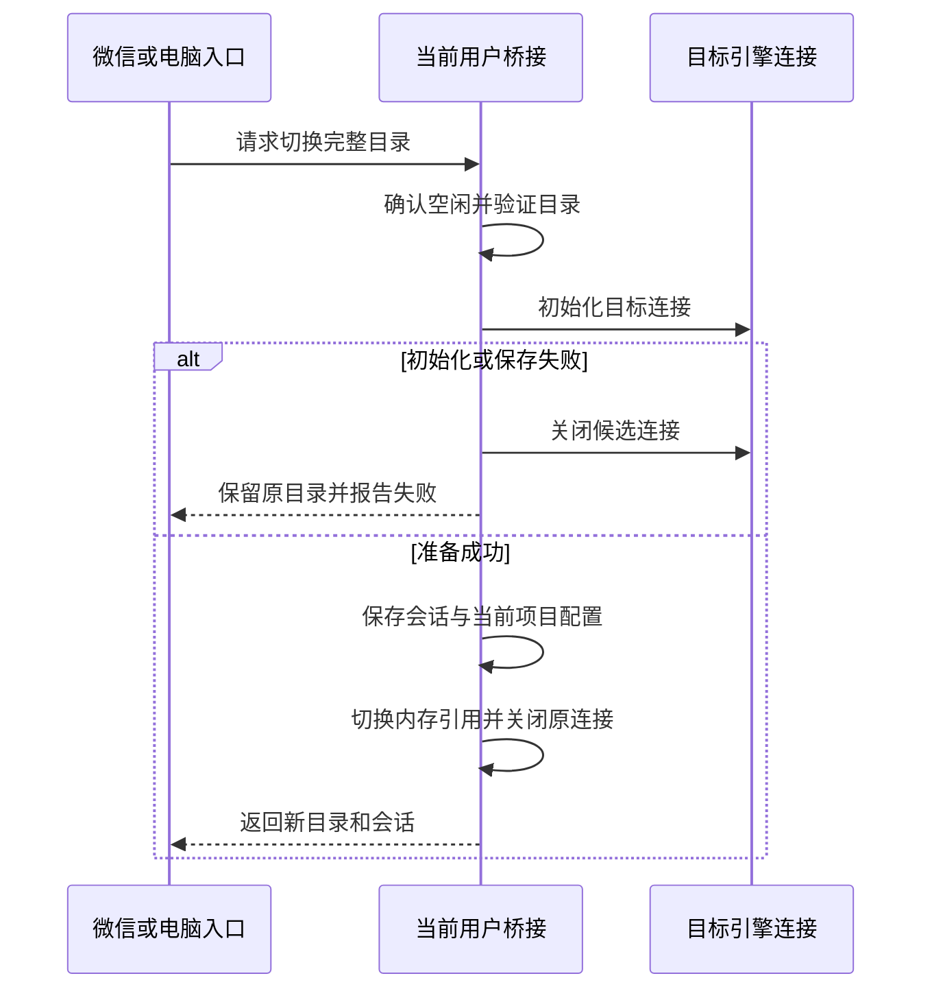

# 工作目录切换方案

任务：20261019-feature-switch-workspace；方案版本 1；基线：requirement.md；2026-10-19。

## 1. 用户可见方案

微信新增 `/目录` 查看当前目录与已使用项目，`/目录 完整路径` 切换；`/工作目录` 和 `/切换目录` 为相同入口，带参数时同样要求完整路径。保留 `/项目 名称`。

电脑新增 `wx-agent workspace` 查看当前目录，`wx-agent workspace "完整路径"` 切换；支持现有 `--user 名称`。面板增加完整路径输入框和“切换工作目录”按钮，仍保留项目下拉选项。电脑服务停止时也可以保存下一次启动的目录，不自动启动引擎；运行时成功回复必须表示引擎已就绪、配置已保存。

切换只在空闲时执行。新目录使用独立会话，返回旧目录恢复其当前引擎的会话；同一个目录的多个会话仍共用文件。成功提示显示实际目录和当前会话，停止状态提示“下次启动生效”。原工作目录中的文件和会话保留。

用户已选择允许每个绑定微信用户输入任意已有目录。对此不再增加预登记限制；身份验证、现有工具审批保留。本功能不提供目录创建、文件移动、远程文件系统浏览或操作系统隔离。

## 2. 现状与选择

现状经 projects.mjs、cli.mjs 和 engines.mjs 源码核实：目录通过项目名称查找，会话按真实目录和引擎分组。只给 `/项目` 增加别名仍要求电脑预先登记，不能满足已确认需求。

选用现有项目配置保存目标目录，避免引入与 currentProject 冲突的第二个“当前目录”字段。已有项目目录匹配时复用项目；未匹配时自动生成稳定项目名，并保存到该用户 projects。成本是用户会看到自动生成名称，因此所有回复和面板必须以完整目录为主。将来如需要用户为目录命名，另做重命名功能。

## 3. 路径、身份与兼容性

入口接收字符串，去掉首尾空白；微信可去掉一对匹配的单/双引号以便复制路径。拒绝空值、控制字符、相对路径以及超过 1024 个 UTF-16 单元的值。不展开 ~、环境变量或 shell 表达式。Windows 使用所在系统的完整绝对路径规则，不接受只有盘符的相对路径或仅根相对路径。

解析已有目录的 realpath，确认是目录且当前进程能够读取/遍历。不以写探针创建任何文件；文件写入是否允许由后续具体任务及引擎决定。符号链接解析为真实目录，不承诺阻止本机其他进程之后改变文件系统。

用户身份来自微信已验证绑定者、命令行 --user 选中的配置，或本机面板鉴权后选择的用户；微信消息不能指定其他用户。用户已确认“任意目录”意味着两个用户可以主动选择相同目录，此时文件可能冲突，但会话仍独立。

规范化目录若与当前目录相同则成功返回，不重建引擎或新建会话。若与登记项目真实目录相同优先当前项目，再按名称稳定排序取首个；失效登记目录跳过。否则生成 dir- 加真实路径 SHA-256 前 20 位的名称；极小概率名称冲突时明确拒绝，不覆盖已有登记。

目录项目、currentProject、projectSessions 都复用既有格式；老版本可读取新增项目，不迁移、不删除数据。default 原目录不被覆盖，用户可随时 /项目 default 返回。

## 4. 切换顺序与失败边界

运行中由用户守护进程作为唯一配置写入者，所有入口进入同一目录切换操作。先检查 stopping/changing、controller.active、tasks.busy；在任何异步路径解析前设置 changing，防止新消息入队、面板变更与恢复定时器竞争。任务回传期间同样视为忙碌。



候选连接基于隔离的候选会话状态初始化，不改写仍在使用的原 controller 状态。先保存合并后的会话记录，再原子替换 config.json；配置替换是目录选择的提交点。合并必须保留原任务恢复计数与所有旧目录、旧引擎会话，队列继续使用相同任务状态引用。配置提交前失败保留原内存配置与连接；会话文件可能多出空候选记录，但不改变当前选择，也不丢失旧记录。

配置提交后立即发布新内存状态、关闭原连接；关闭过程异常不能撤销已经提交的成功选择，记录清理失败供排查。目录切换持有从路径验证到候选清理结束的操作 Promise，由关闭流程追踪；生命周期区分准备、提交中、提交完成或失败。关闭先设置 stopping 并禁止新操作。准备阶段在每个异步步骤结束后检查停止状态：若尚未进入配置写入，则关闭候选并退出操作。关闭流程必须等待整个操作及其会话保存结束，之后才关闭最终连接、释放用户锁、退出进程。

进入配置写入前同步检查 stopping 并把阶段切为提交中，两者之间不允许异步间隙。一旦开始写配置，停止只请求关闭，不中断提交：允许 writeJSON 成功或失败，操作根据结果发布新状态或保留旧状态，并完成旧/候选连接清理；关闭流程等待结果后再退出。提交开始不等于已生效，只有 rename 成功才生效。停止或调用方超时可能使回复缺失，调用方须重新查询状态。进程被强制终止时无法保证清理完成，但用户锁仍按现有存活检测恢复，重启按最后成功 rename 的配置选择目录。

进程在配置提交后、回复前退出，重启读取新目录；用户用 /目录 或面板状态核对，不自动重试请求。

停止状态下，CLI 或面板取得同一用户进程锁，锁内重新读取配置、验证路径并原子保存新项目和 currentProject；不改会话文件。若正在启动或锁被占用，拒绝并提示稍后重试。不能因 IPC 超时就回退离线写配置。运行进程状态不明时拒绝写入。

## 5. 接口约定

沿用本机 POST /api 的 Bearer 凭证、精确 Host/Origin 校验、JSON 与 4096 字节上限；新增 action=workspace，可用于运行或停止用户。字段 user 默认 default，value 是完整目录路径。请求示例：

```json
{"action":"workspace","user":"default","value":"/absolute/path/to/project"}
```

成功示例（运行时 conversation 为会话 ID，停止时为 null）：

```json
{"ok":true,"workspace":"/absolute/path/to/project","project":"dir-0123456789abcdef0123","conversation":null,"applied":"next-start"}
```

applied 只取 live 或 next-start。失败沿用 `{"error":"说明"}`：面板本地校验或离线处理失败 HTTP 400；已转发的管理接口业务失败保留现有 HTTP 200 + error 兼容行为，浏览器两种都必须提示失败。

运行时使用已鉴权 IPC command=admin、action=workspace、value=完整路径，字段语义同上；user 不随 IPC 发送，由所连接用户套接字决定。IPC 请求上限增至 8192 字节，仍只处理一行 JSON，超限关闭连接。HTTP 与 IPC 按 UTF-8 流解码后再解析 JSON，并以原始字节累计限额，避免中文路径字符在网络分块边界被截断；响应也使用流式解码。仅 workspace 的 value 限制为 1024 单元，既有操作保留各自限制；编码后的 HTTP 请求仍可能触及 4096 字节总上限，界面显示请求过大。

admin/inspect 增加 workspace（当前真实目录），保留旧响应字段。面板用户列表中运行时以实际状态为准，停止时从 currentProject 解析配置路径，避免显示旧 default。

CLI 无参数显示当前目录；带一个路径参数执行切换，额外参数报用法错误。有空格的 CLI 路径必须由 shell 引号合并为一个参数。微信从命令后读取整个剩余文本，不按空格拆路径。

IPC 超时 65 秒不自动重发；面板和 CLI 提示结果未确认时，应重新查询状态。所有失败都不执行用户输入字符串，不调用 shell 去处理目录。

## 6. 验证与发布

实现验证：不存在目录、文件、相对路径、含控制字符、空格和中文路径、符号链接规范化、已登记目录复用、同目录重复操作、不覆盖名称冲突项目。兼容 Windows 路径规则及三个系统现有测试矩阵。

进程验证：使用模拟微信和引擎，断言 A→B→A 的 cwd、threadId 与重启目录；忙碌、合并、排队、回传期间拒绝；引擎准备和配置写入失败时旧连接仍可处理后续任务；停止状态配置与启动竞争不得双写。在候选初始化、session 保存、config rename 前后注入停止，验证正常关闭不提前释放用户锁、无候选连接残留、重启目录与实际提交一致。面板验证鉴权、按用户选择、超长请求和用户间会话独立。测试不向真实微信发送，不运行用户项目任务。

发布前同步 README、操作说明和微信帮助；新增版本沿用 GitHub tgz 发布与 wx-agent update，升级保持用户原运行状态。回退旧包仍能按自动登记的项目名切换，但不支持新命令。真实模型对目标目录的实际读写权限、网络文件系统重连和微信真实链路属于发布后人工验证，不用模拟测试宣称已证明。

## 7. 审核与确认

本方案已通过独立审查的四轮复审（subagent，见 design-review.md 第二次记录），用户已于 2026-10-19 在本会话回复“确认方案”。当前无未决权限选择；路径权限与并发/失败保证需要实现验证。主要已接受风险是所有绑定用户都能选择其他可访问本机目录，这不提供文件隔离。完整审查结果记入 design-review.md。
