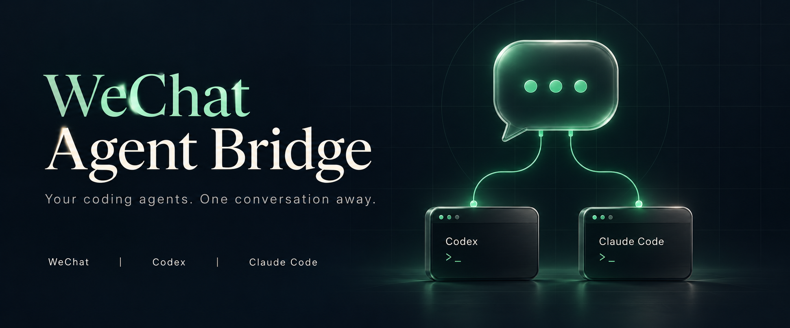
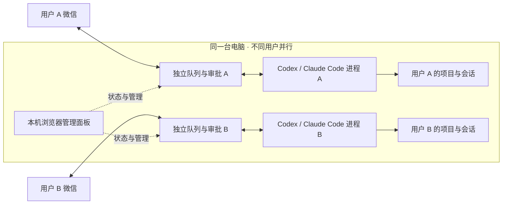

<p align="center">
  
</p>

<h1 align="center">WeChat Agent Bridge</h1>

<p align="center"><strong>一台电脑，多个微信用户，AI 任务同时运行。</strong></p>
<p align="center">多人分别扫码 · 双引擎切换 · 本机可视化管理<br />让你和家人、协作者，通过各自的微信使用本机 Codex / Claude Code。</p>

<p align="center">
  <a href="https://github.com/zhouqise/wechat-agent-bridge/releases/latest"></a>
  <a href="https://github.com/zhouqise/wechat-agent-bridge/actions/workflows/test.yml"></a>
  <a href="LICENSE"></a>
  <a href="#多人共享一台电脑"></a>
  
  
</p>

<p align="center">
  <a href="#快速开始">快速开始</a> ·
  <a href="#功能概览">功能概览</a> ·
  <a href="#多人共享一台电脑">多用户并行</a> ·
  <a href="#本机管理面板">管理面板</a> ·
  <a href="#连接恢复与安静通知">连接与通知</a> ·
  <a href="#微信操作速查">微信命令</a> ·
  <a href="#文档导航">完整文档</a> ·
  <a href="https://github.com/zhouqise/wechat-agent-bridge/releases/latest">下载</a> ·
  <a href="CHANGELOG.md">更新记录</a>
</p>

---

## 多人共享一台电脑

**电脑端安装一次，每个人用自己的微信扫码，分别发起任务。**你可以处理代码，家人或协作者可以同时分析文档；不同用户并行运行，各自的任务按顺序执行。

| 每个用户独立管理 | 所有用户共同使用 |
| --- | --- |
| 微信绑定、任务队列和审批 | 本机安装的 Codex / Claude Code |
| 项目目录、会话列表和最近结果 | 引擎登录、账号额度与 API 配置中的密钥环境变量 |
| 引擎选择、模型设置和输出文件 | 电脑的 CPU、内存与网络 |

完成下方基础安装后，添加一个用户，让对方用自己的微信扫码：

```bash
wx-agent user add teammate     # 创建独立工作区，扫码后自动启动
wx-agent dashboard            # 浏览器集中管理所有用户
```

也可直接在面板点击「新增用户并绑定」，让对方扫码，绑定后自动启动。选择用户即可查看其状态、队列和会话，分别启动或空闲时停止服务；也可用 `wx-agent user list` 查看所有用户。

原有用户为 `default`，不带 `--user` 的命令继续管理默认用户。工作区分离属于应用层管理，**不是操作系统安全隔离**；获批命令仍以本机用户权限执行。详见[多用户使用指南](docs/operations.md#多用户同时运行)。

## 功能概览

| 能力 | 可以做什么 |
| --- | --- |
| **多用户并行** | 多人分别扫码；工作区、队列、上下文与审批分别管理 |
| **本机管理面板** | 页面新增用户扫码、管理启停与会话、查看可选模型、配置认证和实时日志 |
| **连接恢复与安静通知** | 接收故障持续重试，引擎断开自动重建；短任务直接回结果，长任务延迟提示 |
| **双引擎与模型切换** | 微信切换 Codex / Claude Code；支持本机登录、API Key、自定义接口和模型设置 |
| **多项目、多会话** | 直接切换已有目录或已登记项目；创建、切换、删除会话，或清空当前列表并新建；各组上下文独立 |
| **连续消息合并** | 先发文件再补说明，或连续发截图，合并成一项任务 |
| **每用户任务队列** | 忙碌时自动排队；查看任务、立即提交、按编号取消或清空等待队列 |
| **截图与扫描 PDF OCR** | 图片交给模型分析，并可补充本地中英文 OCR；扫描 PDF 按页补充识别文字 |
| **文档处理与自动回传** | 处理 PDF、Excel、Word、PPT、文本附件；成功任务的新结果文件自动发回微信 |
| **视频综合分析** | 视频抽帧 + 音轨分段转文字 + 模型结合分析，支持最长 30 分钟、200 MB 的 MP4 |
| **网页内容分析** | 提取公开网页静态正文，用于总结、比较与追问 |
| **单次审批与后台运行** | 微信确认需授权操作；桥接后台运行，`wx-agent update` 升级并保留配置 |

## 快速开始

准备 **Node.js 22+、npm、系统 curl**，以及至少一种已安装并完成认证配置的引擎：[Codex CLI](https://developers.openai.com/codex/cli/) 或 [Claude Code](https://code.claude.com/docs/en/setup)。

### 1. 安装并启动

macOS / Linux：

```bash
npm install -g https://github.com/zhouqise/wechat-agent-bridge/releases/download/v0.22.0/wx-codex-bridge-0.22.0.tgz --ignore-scripts
wx-agent setup
wx-agent start
```

Windows PowerShell：

```powershell
npm.cmd install -g https://github.com/zhouqise/wechat-agent-bridge/releases/download/v0.22.0/wx-codex-bridge-0.22.0.tgz --ignore-scripts
wx-agent.cmd setup
wx-agent.cmd start
```

向导支持 `codex`、`claude`、`both`（两个都配置，也可输入 `3`）。选择 `both` 后，分别设置两套认证、模型和代理，再选择默认引擎；工作目录与微信扫码只设置一次。两个 CLI 需预先安装，向导不会自动安装它们。工作目录可直接回车，使用独立空白工作区，之后无需每条消息指定目录。

安装包通过 GitHub Releases 提供，尚未发布到 npm。全局目录权限、引擎安装及代理配置见[完整安装指南](docs/setup.md)。

### 2. 在微信验证连接

向已绑定的机器人发送：

> 不要调用工具，只回复：微信 AI 助手已连通。

收到回复后，就可以发任务、截图或文件。基础文字任务无需安装下方的媒体处理组件。

### 3. 打开管理面板

```bash
wx-agent dashboard
```

Windows PowerShell 可使用 `wx-agent.cmd dashboard`。浏览器会自动打开；若未自动打开，复制终端输出的完整链接即可。之后可在面板里查看状态、启停服务和管理会话，**无需进入安装目录**。

### 4. 按需处理文件

```text
发送：一份 PDF / Excel / Word / PPT
随后发送：总结重点，并把结果整理成 Word 文档。
发送：/开始
```

先按下方[媒体与文档能力](#按需开启媒体与文档能力)安装对应组件。桥接将附件和说明合并，交给当前引擎；需要授权的操作会在微信请求单次确认。成功任务在 `wx-agent-output` 中新增或修改的受支持文件会自动回传，最多 5 份、每份 20 MB；也可发送 `/文件` 手动取回。

## 本机管理面板

**微信发任务，浏览器管运行。**执行 `wx-agent dashboard`，即可集中查看这台电脑上的全部已配置用户。

| 面板区域 | 可用操作 |
| --- | --- |
| 用户与连接 | 新增用户、扫码及配对码绑定；查看微信连接、引擎状态、工作区及最近接收时间 |
| 服务启停 | 启动指定用户；仅在空闲时停止，避免打断任务 |
| 任务 | 查看执行中的任务、当前阶段和等待队列 |
| 会话 | 新建、切换、删除；清空当前用户、项目、引擎的列表并新建 |
| 引擎与模型 | 切换引擎；当前引擎可选模型直接显示在按钮下方，点击填入模型 ID |
| 工作目录 | 输入完整路径，或使用「已保存目录」快捷切换；文件不会移动 |
| 账号认证 | 分别设置两种引擎的认证方式、API 地址、密钥环境变量名和模型 |
| 日志 | 自动刷新末尾日志、跟随最新；确认后清除当前及轮转日志 |

工作目录和模型可在停止时保存，下次启动生效；运行时切换需要任务空闲。认证配置须先停止该用户服务再保存，然后手动启动。页面只引用环境变量，不接收密钥；变量来自启动面板的终端，改变后需重新打开面板。本机账号的登录/换号仍由官方 CLI 完成。

会话按用户、目录、引擎及认证配置分组：更换认证方式、API 地址或密钥变量名后从独立会话开始，切回原配置可恢复。更换同名变量的密钥或 CLI 账号无法自动识别，请手动新建会话。模型切换保留上下文。

「已保存目录」就是给常用工作目录起的名称，原 `/项目` 命令继续可用。新名称登记使用 CLI。取消任务、清空队列及审批继续在微信完成；面板会话与引擎操作需要服务运行且空闲。

面板仅监听 `127.0.0.1`，每次启动使用随机访问凭证，完整链接请勿分享。**面板终端需保持运行**；按 Ctrl+C 只关闭面板，已启动的桥接服务继续在后台运行。

## 连接恢复与安静通知

默认采用安静通知，减少普通任务的重复进度消息：

- **普通短任务**：直接返回结果。
- **较长任务**：超过 8 秒仍在处理且未等待审批时，补发一条进度，可用 `/状态` 随时查询。
- **附件合并、排队、审批和错误**：保留必要提示。

需要更详细的过程提示时，在面板的「通知模式」中选择「完整进度」并保存。通知设置按用户保存。

| 情况 | 桥接如何处理 |
| --- | --- |
| 微信接收网络异常 | 持续退避重试，最长间隔约 61 秒，不再因连续 5 次失败退出 |
| 引擎进程连接断开 | 等待当前任务收尾后重建连接；当前桥接进程内未提交的队列任务保留，恢复后继续 |
| 任务已提交，但执行结果不确定 | 不自动重跑；先核对工作区与 `/结果`，再决定是否重发 |
| 回复发送未确认 | 不自动重复发送，可用 `/结果` 获取最近保留结果 |
| 微信登录失效 | 停止服务，需要重新绑定；[查看操作步骤](docs/operations.md) |
| 桥接进程退出或电脑重启 | 需重新启动服务；内存队列不会跨进程重放 |

连接恢复依赖桥接进程仍在运行，不等于开机自启或进程守护。电脑需保持唤醒和联网。

## 在微信管理任务与上下文

### 连续消息合并，不用一次写完

- **连续文字**：等待最后一条消息后的 1.5 秒。
- **包含附件**：等待最后一条消息后的 8 秒，方便补充说明或继续上传。
- **最长合并等待**：从第一条消息起 20 秒；发送 `/开始` 可立即提交。
- **忙碌时**：新任务进入当前用户的队列，最多 10 个等待任务；其他用户继续并行。

要开始另一项独立任务，可先发送 `/开始`，再发送新内容。`/任务` 查看队列，`/取消 任务编号` 移除指定等待任务，`/清空队列` 移除全部等待任务。

队列内容保存在内存中，停止或重启后**不会自动重跑**；恢复后会提示核对未确认任务。

### 会话可切换，命令直接复制

发送 `/会话` 或 `/会话列表`，每项显示名称、完整 ID 和可复制命令。例如：

```text
2. 文档整理
ID：a1b2c3d4
/切换会话 a1b2c3d4
快捷：/切换会话 2
/删除会话 a1b2c3d4
```

复制完整命令即可切换，也可直接输入 `/切换会话 2`。**短序号固定，不随排序变化，删除后不复用。**上面的 ID 仅为示例，请使用自己的列表。

- `/新会话 名称`：创建新上下文，保留旧会话；不填名称时自动取第一条任务作为标题。
- `/会话 2`：翻到第 2 页，每页 10 个会话。
- `/结果`：获取当前会话的最近结果。
- `/清空会话`（或 `/清空所有会话`）：清空当前用户、项目和引擎的会话列表，同时创建并切换到新会话。
- `/删除会话 ID`：移除桥接会话记录，保留项目文件和引擎本机历史。

会话按**用户 → 工作目录 → 引擎 → 认证配置**分别管理，每组最多 100 个。运行、排队或回传期间可以查看列表，变更会话需先结束当前任务并清空等待队列。列表只包含本桥接登记的会话，不导入桌面应用或 CLI 的全部历史。

### 一条微信切换工作目录

直接发送已有目录的完整路径，无需提前登记：

```text
/目录
/目录 /Users/yourname/Projects/demo
/目录 C:\Projects\demo
```

`/目录` 查询当前目录，`/工作目录`、`/切换目录` 也是别名。路径可以含空格。运行中的服务会立即切换，首次进入创建会话，返回原目录恢复该引擎的会话；切换前须完成或取消当前任务，并清空等待队列。切换会话不会回滚文件。

电脑端也可在任意位置执行：

```bash
wx-agent workspace "/absolute/path/Project A"
wx-agent --user girlfriend workspace "/absolute/path/Project B"
```

不带路径可查询。服务停止时保存选择，下次启动生效；浏览器面板也提供工作目录输入框。目录必须存在且可访问，不会自动创建，不支持相对路径或 `~`。选择会持久保存，重启后继续使用。

原有 `/项目` 和 `/项目 名称` 继续可用，发送 `/项目 default` 返回安装时配置的默认工作区。也可[为常用目录登记名称](docs/operations.md#登记多个项目)。

**每个绑定用户都可以选择这台电脑上本机账号可访问的任意已有目录。**多用户配置与会话独立，但没有文件系统隔离；仅向可信的人开放绑定，避免多人同时修改同一目录。详见[工作目录管理](docs/operations.md#切换工作目录)。

## 按需开启媒体与文档能力

| 输入 | 处理范围 | 额外准备 |
| --- | --- | --- |
| 截图 | PNG / JPEG / WebP；合并任务最多 4 张，单张 10 MB、合计 20 MB | 支持图像输入的模型；本地 OCR 可选 |
| PDF / Office | 合并任务最多 4 份，每份 20 MB；PDF 文字层、表格及文档文本提取 | Python 3、`wx-agent office-setup` |
| 扫描 PDF / 图片 OCR | 本地中英文识别；每份 PDF 最多尝试 20 个无文字页 | Python 3.10+、Tesseract、`wx-agent ocr-setup` |
| 文本附件 | TXT / MD / CSV / TSV / JSON / LOG / YAML / YML / XML；每份 20 MB | 无需 Python |
| MP4 视频 | 最长 30 分钟、200 MB；6–30 帧，音轨按 2 分钟分段转写 | FFmpeg、whisper.cpp、转写模型 |
| 网页链接 | 每项任务最多 3 个；提取公开静态正文 | 网页需能从本机直连访问 |
| 微信语音 | 使用微信消息附带的转文字；无转文字时提示重发文字 | 不自动识别未附带转文字的语音 |

```bash
wx-agent office-setup   # 安装 PDF / Office 环境
wx-agent office-check   # 检查文档组件
wx-agent ocr-setup      # 已安装 Tesseract 后，安装 OCR 组件及中英文语言包
wx-agent ocr-check      # 检查 OCR 环境
wx-agent media-check    # 检查视频组件及转写模型
```

OCR、视频转写可能存在错漏，视频画面是抽样；Office 复杂版式和 Excel 公式计算需复核。登录页面、JavaScript 动态网页可能无法完整读取。支持格式、安装步骤与详细限制见[媒体与文件指南](docs/media.md)。

## 微信操作速查

| 场景 | 命令 |
| --- | --- |
| 引擎与模型 | `/引擎`、`/引擎 claude`、`/引擎 codex`、`/模型`、`/模型 模型名` |
| 会话管理 | `/会话`、`/新会话 名称`、`/切换会话 序号或ID`、`/删除会话 ID` |
| 清空会话 | `/清空会话`（别名 `/清空所有会话`），清空当前列表并新建 |
| 工作目录 | `/目录`、`/目录 完整路径`（别名 `/工作目录`、`/切换目录`） |
| 项目切换 | `/项目`、`/项目 名称` |
| 队列管理 | `/任务`、`/开始`、`/取消 任务编号`、`/清空队列` |
| 进度与结果 | `/状态`、`/取消`、`/结果` |
| 操作确认 | `/批准 审批编号`、`/拒绝 审批编号`、`/回答 编号 内容` |
| 输出文件 | `/文件`、`/文件 result.pdf` |
| 完整帮助 | `/帮助` |

## 运行与升级

无需进入安装目录，在终端直接执行：

```bash
wx-agent dashboard      # 打开可视化管理面板
wx-agent status         # 查看当前服务状态
wx-agent stop           # 停止默认用户
wx-agent start          # 后台启动默认用户
wx-agent logs           # 查看最近日志
wx-agent update --check # 只检查新版本
wx-agent update         # 升级到最新稳定版
```

升级后运行 `wx-agent dashboard` 即可使用新版面板。升级保留配置、微信绑定和会话记录；原本停止的服务保持停止，原本运行且空闲的默认服务升级后重启。执行、排队或回传中会拒绝升级；多用户使用时，先停止新增用户，升级后分别启动。重新绑定、停用用户与恢复说明见[运维指南](docs/operations.md)。

## 它如何工作



每个用户有独立 Bridge 进程，连接自己当前选择的引擎。原始资料或提取内容会提交给所选模型服务；本机运行桥接、OCR 和视频预处理，不代表模型推理离线。

## 文档导航

| 文档 | 内容 |
| --- | --- |
| [安装与首次配置](docs/setup.md) | 三平台安装、扫码、工作目录与代理 |
| [引擎、认证与模型](docs/engines.md) | 本机登录、API Key、自定义接口与模型切换 |
| [媒体与文件](docs/media.md) | 截图、OCR、音视频、网页、文档处理和自动回传 |
| [运维与多用户](docs/operations.md) | 管理面板、连接恢复、通知、多用户、任务队列、项目、会话与升级 |
| [开发与贡献](docs/development.md) | 本地验证、打包、协议参考与反馈方式 |
| [安全说明](SECURITY.md) · [更新记录](CHANGELOG.md) | 权限边界及版本变化 |

## 使用前了解

- 电脑需保持唤醒和联网；后台运行不等于开机自启，重启电脑后需再次启动。
- 支持绑定用户的私聊，不支持群聊；能否扫码绑定取决于微信服务端。
- macOS 已有真实连接验证；Windows / Linux 有跨平台自动测试，完整微信与模型链路仍需实机确认。
- 独立开源项目，非腾讯、OpenAI 或 Anthropic 官方产品。请勿在 Issues 中上传二维码、密钥或会话文件。

## 开源与反馈

采用 [MIT 许可证](LICENSE)。欢迎提交 [Issue](https://github.com/zhouqise/wechat-agent-bridge/issues) 或 Pull Request，请附平台、版本、复现步骤和脱敏日志。

<p align="center"><sub>WeChat Agent Bridge · Your coding agents. One conversation away.</sub></p>
