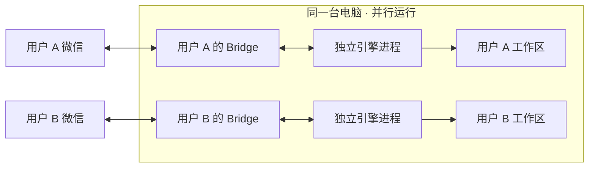

<p align="center">
  
</p>

<h1 align="center">WeChat Agent Bridge</h1>

<p align="center"><strong>一台电脑，多个微信用户，AI 任务同时运行。</strong></p>
<p align="center">多人分别扫码 · 任务并行执行 · 会话与审批独立<br />让你和家人、协作者，通过各自的微信使用本机 Codex / Claude Code。</p>

<p align="center">
  <a href="https://github.com/zhouqise/wechat-agent-bridge/releases/latest"></a>
  <a href="https://github.com/zhouqise/wechat-agent-bridge/actions/workflows/test.yml"></a>
  <a href="LICENSE"></a>
  <a href="#多人共享一台电脑"></a>
  
  
</p>

<p align="center">
  <a href="#快速开始">快速开始</a> ·
  <a href="#你可以用它做什么">功能概览</a> ·
  <a href="#多人共享一台电脑">多用户并行</a> ·
  <a href="docs/setup.md">完整文档</a> ·
  <a href="https://github.com/zhouqise/wechat-agent-bridge/releases/latest">下载</a> ·
  <a href="CHANGELOG.md">更新记录</a>
</p>

---

## 多人共享一台电脑

**电脑端安装一次，多人分别扫码，各自发起任务。**你可以处理代码，她可以分析文档；不同用户的任务同时运行，无需等另一个用户完成。

| 每个用户独立拥有 | 所有用户共用 |
| --- | --- |
| 微信绑定、聊天上下文与模型选择 | 电脑上安装的 Codex / Claude Code |
| 工作目录、上传附件与生成文件 | 本机引擎登录与账号额度 |
| 审批编号、任务进度与执行结果 | CPU、内存等机器资源 |

完成基础安装后，一条命令添加用户，让对方用自己的微信扫码：

```bash
wx-agent user add teammate     # 创建工作区，扫码后自动启动
wx-agent user list             # 查看所有用户
wx-agent user status teammate  # 查看指定用户状态
wx-agent user stop teammate    # 只停止指定用户
```

**不同用户可并行，每个用户依次处理队列中的任务。**会话、工作目录、审批和结果分别管理；引擎登录、账号额度和机器资源共用。原有账号保留为 `default`，原命令继续管理默认用户。

工作区分离不等于操作系统安全隔离，获批命令仍以本机用户权限执行。添加、重新绑定、停用与归档见[多用户文档](docs/operations.md#多用户同时运行)。

## 从一条微信，开始一项任务

电脑上运行你的 Codex 或 Claude Code，微信负责发起任务、接收结果和确认操作。扫码绑定后，就能在私聊中继续处理项目、分析资料，或查看执行进度。

```text
你 → “检查这个项目的测试失败原因，先说明修复方案。”
你 → 发一张报错截图：“这个问题怎么解决？”
你 → 发一份 PDF：“按页总结重点，列出需要确认的信息。”
你 → “总结这个网页：https://example.com/article”
```

以上为使用示例。需要权限确认的操作会返回审批请求，结果回到发起任务的微信会话。

## 你可以用它做什么

| 能力 | 使用方式 |
| --- | --- |
| **多用户并行** | 分别扫码绑定，独立工作区、会话和审批，多个用户可以同时执行任务。 |
| **双引擎与模型切换** | 在微信切换 Codex / Claude Code，分别保留上下文；支持本机登录和 API Key 配置。 |
| **截图分析** | 直接发送截图，结合报错、界面和文字继续追问。 |
| **视频画面 + 音轨分析** | 抽帧、分段离线转写，再交给模型结合分析；支持最长 30 分钟、200 MB 的 MP4。 |
| **文档与数据处理** | 读取 PDF、Excel、Word、PPT 和常用文本附件；成功任务的新结果文件自动回传，也可手动取回。 |
| **网页链接分析** | 提取公开网页的静态正文，支持总结、比较和来源标注。 |
| **连续消息与队列** | 文件 + 后续说明、连续截图自动合并；每用户独立排队，支持立即提交和按编号取消。 |
| **多项目切换** | 微信 `/项目` 选择本机登记的目录，各项目、各引擎分别保留会话。 |
| **任务控制与审批** | 查看状态、取消任务、恢复上下文，并对需要确认的操作作单次审批。 |
| **后台运行与升级** | 关闭终端后继续运行，使用 `wx-agent update` 检查并安装最新稳定版。 |

## 快速开始

准备 **Node.js 22+、npm、系统 curl**，以及至少一种已安装并配置认证的引擎：[Codex CLI](https://developers.openai.com/codex/cli/) 或 [Claude Code](https://code.claude.com/docs/en/setup)。

### 1. 安装

macOS / Linux：

```bash
npm install -g https://github.com/zhouqise/wechat-agent-bridge/releases/download/v0.17.0/wx-codex-bridge-0.17.0.tgz --ignore-scripts
```

Windows PowerShell：

```powershell
npm.cmd install -g https://github.com/zhouqise/wechat-agent-bridge/releases/download/v0.17.0/wx-codex-bridge-0.17.0.tgz --ignore-scripts
```

安装包通过 GitHub Releases 提供，尚未发布到 npm。没有全局目录写入权限时，参见[用户目录安装](docs/setup.md#安装)。

### 2. 配置并启动

```bash
wx-agent setup
wx-agent start
```

按提示选择引擎、认证方式、工作目录和代理，再用自己的微信扫码。工作目录可直接回车使用独立空白工作区，无需每条消息都指定目录。Windows PowerShell 可使用 `wx-agent.cmd`。

### 3. 发起第一次对话

在微信中向已绑定的机器人发送：

> 不要调用工具，只回复：微信 AI 助手已连通。

收到回复后，就可以发送任务、截图或文件。安装及网络问题参见[完整配置指南](docs/setup.md)。

## 按需开启媒体与文档能力

基础文字任务不需要安装下面的可选组件。

| 输入 | 当前范围 | 额外准备 |
| --- | --- | --- |
| 截图 | PNG / JPEG / WebP；每条最多 4 张 | 使用支持图像输入的模型 |
| PDF / Office | 每条 1 份、最大 20 MB；PDF 提取文字层及页码 | Python 3，运行 `wx-agent office-setup` |
| 文本附件 | TXT / MD / CSV / TSV / JSON / LOG / YAML / YML / XML | 无需 Python |
| MP4 视频 | 最长 30 分钟、200 MB；6–30 帧，按 2 分钟分段转写 | FFmpeg、whisper.cpp、转写模型 |
| 网页链接 | 每条最多 3 个；读取公开静态正文 | 网页需能从本机直连访问 |
| 微信语音 | 使用微信消息附带的转文字 | 无转文字时需重发文字 |

```bash
wx-agent office-setup   # 安装 PDF / Office 处理环境
wx-agent office-check  # 检查文档组件
wx-agent media-check   # 检查视频组件和转写模型
```

**能力边界：**扫描版 PDF 支持本地 OCR（需可选组件，每份最多 20 个无文字页）；登录或 JavaScript 动态网页可能无法完整读取；视频画面为抽样，转写可能有错漏。更多格式、限制和组件安装方法见[媒体与文件指南](docs/media.md)。

## 常用命令，一眼找到

### 在微信里

| 命令 | 功能 |
| --- | --- |
| `/引擎`、`/引擎 claude`、`/引擎 codex` | 查看或切换引擎 |
| `/模型`、`/模型 模型名` | 查看目录或切换模型 |
| `/任务`、`/开始`、`/取消 编号` | 查看队列、立即提交、移除等待任务 |
| `/项目`、`/项目 名称` | 列出并切换登记项目 |
| `/状态`、`/取消` | 查看进度或中断当前任务 |
| `/新会话`、`/结果` | 开启新上下文或获取最近结果 |
| `/批准 编号`、`/拒绝 编号` | 处理本次操作审批 |
| `/文件`、`/文件 result.pdf` | 查看和取回生成文件 |
| `/帮助` | 查看完整命令说明 |

### 在电脑上

```bash
wx-agent status         # 查看当前服务状态
wx-agent stop           # 停止默认用户的桥接
wx-agent start          # 后台启动默认用户
wx-agent logs           # 查看最近日志
wx-agent update --check # 只检查新版本
wx-agent update         # 升级到最新稳定版
```

升级保留配置与绑定。任务执行中会拒绝升级；多用户使用时，先停止新增用户，升级后分别启动。服务管理、重新绑定和工作区迁移见[运维指南](docs/operations.md)。

## 它如何工作



每个用户运行独立 Bridge 进程，连接该用户当前选择的引擎。桥接保留会话引用和任务状态，不接管 Codex 桌面应用已有聊天。原始资料或提取内容会提交给所选模型服务；本机运行桥接不代表模型推理离线。

## 文档导航

| 文档 | 内容 |
| --- | --- |
| [安装与首次配置](docs/setup.md) | 三平台安装、扫码、工作目录与代理 |
| [引擎、认证与模型](docs/engines.md) | 本机登录、API Key、自定义接口与模型切换 |
| [媒体与文件](docs/media.md) | 截图、音视频、网页、PDF、Office 和文本附件 |
| [运维与多用户](docs/operations.md) | 启停、升级、重新绑定、恢复、独立用户 |
| [开发与贡献](docs/development.md) | 本地验证、打包、协议参考与反馈方式 |
| [安全说明](SECURITY.md) · [更新记录](CHANGELOG.md) | 权限边界及版本变化 |

## 使用前了解

- 电脑需保持唤醒和联网；后台运行不等于开机自启，重启电脑后需再次启动。
- 支持绑定用户的私聊，不支持群聊。账号能否扫码绑定取决于微信服务端。
- macOS 已有真实连接验证；Windows/Linux 有跨平台自动测试，完整微信与模型链路仍需实机确认。
- 独立开源项目，非腾讯、OpenAI 或 Anthropic 官方产品。请保管好凭据，不要在 Issues 中上传二维码、密钥或会话文件。

## 开源与反馈

采用 [MIT 许可证](LICENSE)。欢迎提交 [Issue](https://github.com/zhouqise/wechat-agent-bridge/issues) 或 Pull Request，说明平台、版本、复现步骤和脱敏日志。

<p align="center"><sub>WeChat Agent Bridge · Your coding agents. One conversation away.</sub></p>

### 连续消息、项目与 OCR

先发附件，再在 8 秒内发送说明，桥接会合并为一个任务；连续文字合并窗口为 1.5 秒，总等待不超过 20 秒。发送 `/开始` 可立即提交；同一用户忙碌时新任务进入队列，不同用户继续并行。

电脑登记项目后，在微信用 `/项目 名称` 切换：

```bash
wx-agent stop
wx-agent project add demo /absolute/path/to/project
wx-agent start
```

截图与扫描 PDF 可启用本地 OCR：先安装 Tesseract，再运行 `wx-agent ocr-setup`（自动下载并校验中英文语言包），用 `wx-agent ocr-check` 验证。详见[OCR 安装与限制](docs/media.md#本地-ocr)。
